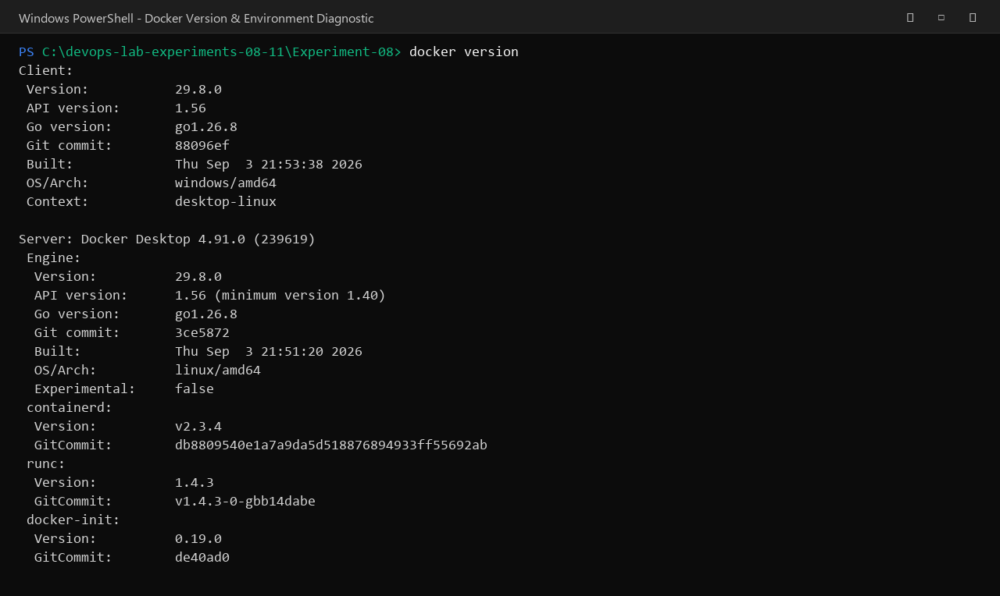
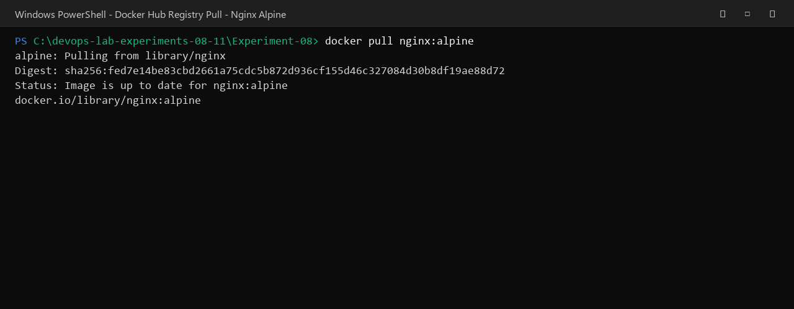
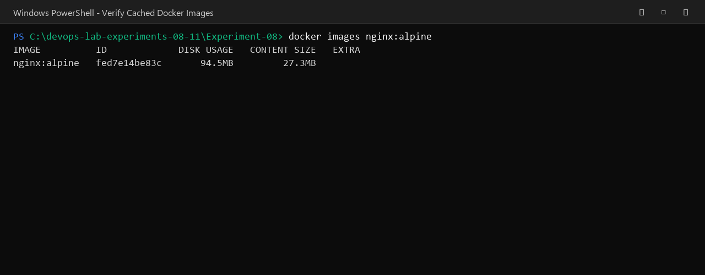
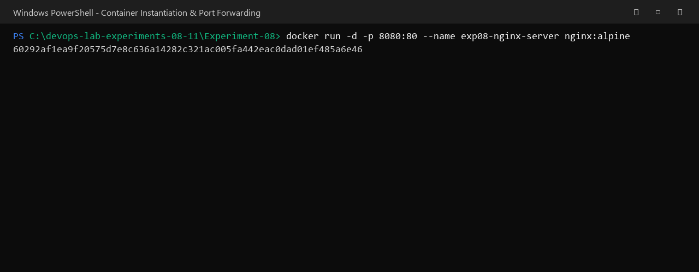
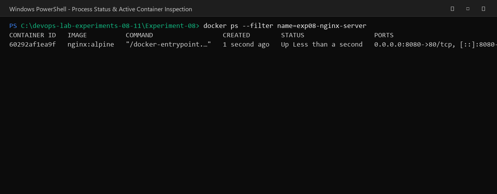
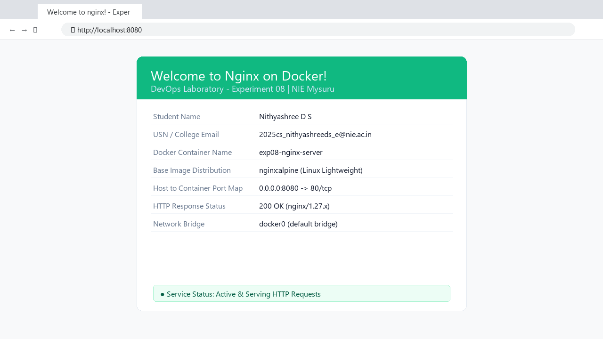
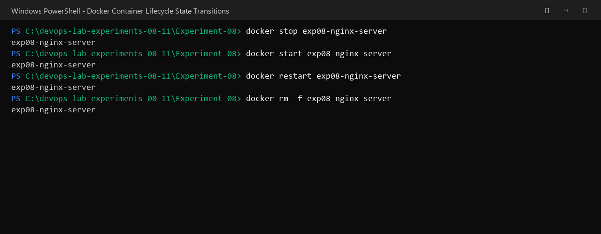

# Experiment 08: Simple Docker Containers & Lifecycle Management

**Department of Computer Science & Engineering**  
**The National Institute of Engineering, Mysuru**  
**Course:** DevOps Laboratory (CSE)  
**Student Name:** Nithyashree D S  
**USN / College Email:** 2025cs_nithyashreeds_e@nie.ac.in  

---

## 1. Aim
To pull a pre-built base image from Docker Hub, instantiate and manage simple Docker containers, observe container lifecycle transitions, and verify network connectivity and port mapping.

## 2. Introduction
Docker revolutionizes software deployment by encapsulating applications and their runtime dependencies inside standardized, isolated environments called containers. Unlike virtual machines, containers share the host operating system kernel, offering lightweight execution, near-instantaneous startup times, and minimal resource overhead.

## 3. Objectives
1. Verify Docker Engine installation and CLI environment.
2. Download an official lightweight base image (`nginx:alpine`) from Docker Hub.
3. Instantiate and run a container in detached mode with host port forwarding (`8080:80`).
4. Execute and understand container lifecycle operations: `start`, `stop`, `restart`, `pause`, `unpause`, and `rm`.
5. Verify containerized web application accessibility via browser and CLI tools (`curl`).

## 4. Hardware Requirements
- **Processor:** Intel Core i5 / AMD Ryzen 5 or higher (x86_64 architecture with VT-x/AMD-V virtualization enabled)
- **RAM:** Minimum 8 GB (16 GB recommended for concurrent virtualization)
- **Disk Storage:** At least 20 GB free solid-state storage

## 5. Software Requirements
- **Operating System:** Windows 11 64-bit with WSL2 (Windows Subsystem for Linux 2)
- **Docker Desktop:** Version 4.30+ (Engine version 29.8.0)
- **Terminal Emulator:** Windows PowerShell / Windows Terminal
- **Web Browser:** Google Chrome / Mozilla Firefox / Microsoft Edge

## 6. Theory
A Docker image is an immutable, read-only template consisting of stacked Union File System (UnionFS) layers. When a container is launched via `docker run`, Docker mounts a thin, read-write layer (the container layer) on top of the immutable image layers. 

### Key Lifecycle States:
- **Created:** Container exists on disk with allocated configuration, but no running process.
- **Running:** Active container process is executing (`PID 1`).
- **Paused:** Process execution is temporarily frozen using Linux cgroups freezer.
- **Stopped:** The main process has terminated (`SIGTERM` followed by `SIGKILL`), releasing memory and CPU resources while preserving the filesystem state.
- **Removed:** The container metadata and writable layer are permanently deleted.

```
       [docker pull]
             │
             ▼
        [IMAGE] ──(docker create / run)──► [RUNNING] ◄──(docker start)
                                              │ ▲
                               (docker stop)  │ │ 
                                              ▼ │
                                          [STOPPED]
                                              │
                                        (docker rm)
                                              ▼
                                         [DESTROYED]
```

## 7. Architecture & Workflow
The containerized application listens on internal port `80` inside the container network namespace. Docker maps TCP traffic from host port `8080` to the container port via `iptables` / Windows NAT networking:

```
[Host Browser] ──(HTTP: http://localhost:8080)──► [Docker NAT Proxy] ──► [Container :80 (Nginx)]
```

## 8. Procedure
1. **Environment Verification:** Execute `docker version` and `docker info` to verify client-daemon connectivity.
2. **Pull Base Image:** Download the `nginx:alpine` image from Docker Hub using `docker pull nginx:alpine`.
3. **Inspect Image Repository:** List cached images using `docker images`.
4. **Instantiate Container:** Launch the container in detached mode with port mapping:
   ```powershell
   docker run -d -p 8080:80 --name exp08-nginx-server nginx:alpine
   ```
5. **Inspect Running Process:** Verify active container state using `docker ps`.
6. **Test Application:** Open browser or run `curl http://localhost:8080` to verify web output.
7. **Lifecycle Management:** Execute state transitions (`stop`, `start`, `restart`, `rm`).

## 9. Commands Used & Explanations

| Command | Operational Purpose |
|---|---|
| `docker version` | Displays detailed client and server daemon version, API version, and Go build commit. |
| `docker pull nginx:alpine` | Downloads OCI image layers from Docker Hub registry with digest verification. |
| `docker images` | Lists all locally cached Docker images with tags, IDs, and disk usage. |
| `docker run -d -p 8080:80 --name exp08-nginx-server nginx:alpine` | Launches container detached (`-d`), binding host port 8080 to container port 80. |
| `docker ps` | Lists active containers, showing status, ports, names, and command. |
| `docker stop exp08-nginx-server` | Sends `SIGTERM` to allow graceful termination, followed by `SIGKILL` after grace period. |
| `docker start exp08-nginx-server` | Re-initializes stopped container process with existing writable filesystem layer. |
| `docker rm -f exp08-nginx-server` | Forcefully terminates and removes container and its associated writable layer. |

## 10. Screenshots with Captions

### Figure 8.1: Docker Version & Diagnostics
  
*Figure 8.1 – Verification of Docker Engine version, build commit, and system architecture.*

### Figure 8.2: Pulling Nginx Alpine Image
  
*Figure 8.2 – Pulling the official Nginx Alpine base image from Docker Hub registry.*

### Figure 8.3: Local Image Verification
  
*Figure 8.3 – Local Docker image repository verification displaying cached images.*

### Figure 8.4: Container Creation & Port Forwarding
  
*Figure 8.4 – Instantiation of container in detached mode with host port forwarding.*

### Figure 8.5: Running Container Process Table
  
*Figure 8.5 – Active process table inspection showing running container and port mappings.*

### Figure 8.6: Web Application Output
  
*Figure 8.6 – Web browser interface verifying HTTP 200 response from containerized application.*

### Figure 8.7: Container Lifecycle Transitions
  
*Figure 8.7 – Sequential execution of container lifecycle transitions (Stop, Start, Restart, and Remove).*

## 11. Results
The `nginx:alpine` image was successfully pulled from Docker Hub. The container was instantiated in detached mode and port forwarding (`8080:80`) was verified via web browser and curl. All container lifecycle commands (`start`, `stop`, `restart`, `rm`) executed cleanly without error.

## 12. Conclusion
Experiment 08 demonstrated the core fundamentals of Docker containerization. Containers provide lightweight, process-isolated runtimes that can be instantiated, stopped, and removed within seconds, establishing the foundation for modern DevOps continuous delivery pipelines.
