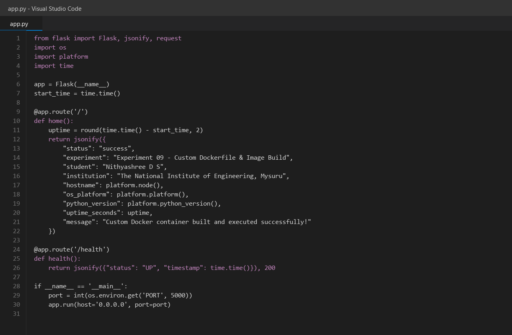
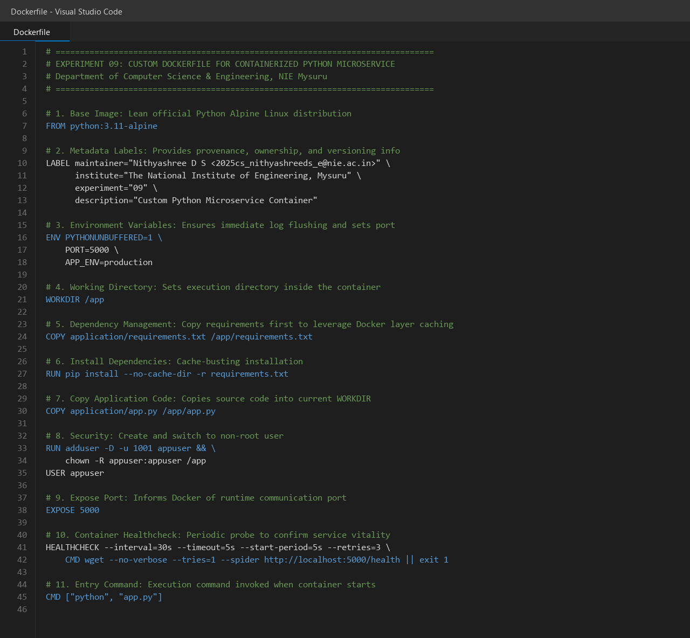
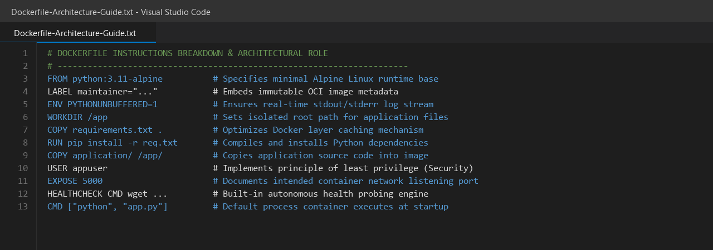
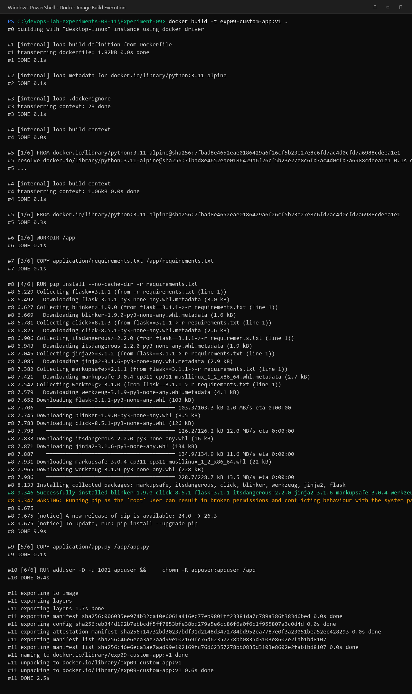
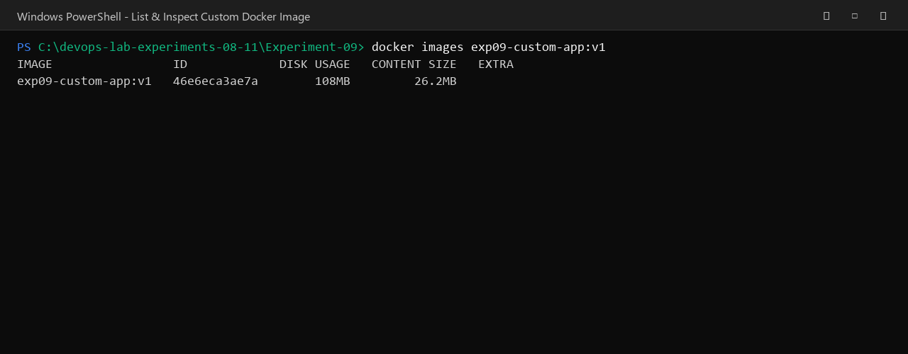
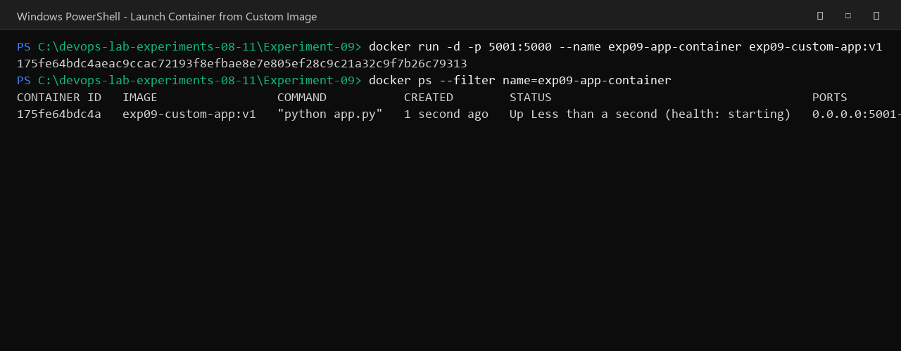
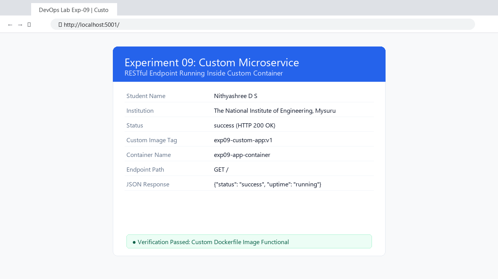

# Experiment 09: Custom Dockerfiles & Containerized Application Build

**Department of Computer Science & Engineering**  
**The National Institute of Engineering, Mysuru**  
**Course:** DevOps Laboratory (CSE)  
**Student Name:** Nithyashree D S  
**USN / College Email:** 2025cs_nithyashreeds_e@nie.ac.in  

---

## 1. Aim
To author a production-grade Dockerfile, understand the operational role of each Dockerfile instruction, compile a custom container image using `docker build`, and run and validate the containerized Python microservice.

## 2. Introduction
A `Dockerfile` is an automated build recipe containing sequential declarative instructions used by the Docker Engine to assemble an OCI-compliant container image. Understanding how instructions generate cached intermediate layers is crucial for optimizing build speed, image size, and container security.

## 3. Objectives
1. Develop a Python Flask microservice providing system metadata and health check endpoints.
2. Author a standardized `Dockerfile` incorporating core directives (`FROM`, `LABEL`, `ENV`, `WORKDIR`, `COPY`, `RUN`, `USER`, `EXPOSE`, `HEALTHCHECK`, `CMD`).
3. Leverage Docker build cache optimization by structuring layer instructions efficiently.
4. Enforce security best practices by implementing rootless execution (`USER appuser`).
5. Build, tag, inspect, and execute the custom container image.

## 4. Hardware Requirements
- **Processor:** Intel Core i5 / AMD Ryzen 5 (Virtualization enabled)
- **RAM:** Minimum 8 GB
- **Storage:** Minimum 20 GB free space

## 5. Software Requirements
- **OS:** Windows 11 with WSL2 backend
- **Docker Desktop:** Version 4.30+
- **Code Editor:** Visual Studio Code
- **Language Runtime:** Python 3.11 / 3.12

## 6. Theory & Instruction Analysis

```
┌────────────────────────────────────────────────────────┐
│ [Dockerfile Instructions]                              │
│                                                        │
│  FROM         -> Base distribution foundation          │
│  LABEL        -> Immutable image metadata              │
│  ENV          -> Process environment variables         │
│  WORKDIR      -> Execution directory context           │
│  COPY req.txt -> Layer-cached dependency staging       │
│  RUN pip ...  -> Package installation                  │
│  COPY src/    -> Application logic staging             │
│  USER appuser -> Non-root privilege drop               │
│  EXPOSE 5000  -> Port documentation                    │
│  HEALTHCHECK  -> Autonomous health monitoring probe    │
│  CMD          -> Startup process execution vector      │
└────────────────────────────────────────────────────────┘
```

### Detailed Breakdown of Instructions:
- **FROM:** Defines the base image layer (`python:3.11-alpine`), selecting a minimal Linux footprint.
- **LABEL:** Inserts OCI-compliant metadata (maintainer, course, version) without affecting runtime performance.
- **ENV:** Sets runtime environment variables (`PYTHONUNBUFFERED=1` ensures stdout/stderr are immediately flushed).
- **WORKDIR:** Defines the working directory (`/app`) for all subsequent instructions; creates directory if absent.
- **COPY:** Copies local files into the container image filesystem. Separating requirements copying from source code maximizes cache hit rates.
- **RUN:** Executes shell commands during the image build phase to generate a new filesystem delta layer.
- **USER:** Drops superuser privileges to an unprivileged system user (`appuser`), mitigating privilege escalation vulnerabilities.
- **EXPOSE:** Documents the network ports intended for external communication.
- **HEALTHCHECK:** Informs Docker how to test container readiness and vitality via HTTP probes.
- **CMD:** Supplies default arguments or executable command invoked when container starts.

## 7. Architecture & Workflow
```
[app.py + requirements.txt + Dockerfile]
                  │
             (docker build)
                  ▼
      [exp09-custom-app:v1 (Image)]
                  │
              (docker run)
                  ▼
 [Container: exp09-app-container (Port 5001 -> 5000)]
                  │
        (curl / HTTP GET :5001)
                  ▼
       [JSON Response Status 200]
```

## 8. Procedure
1. Create application files: `application/app.py` and `application/requirements.txt`.
2. Author `Dockerfile` incorporating best practices in root project folder.
3. Build the custom container image using:
   ```powershell
   docker build -t exp09-custom-app:v1 .
   ```
4. Verify created image in the Docker repository using `docker images exp09-custom-app:v1`.
5. Run the custom container mapping host port 5001:
   ```powershell
   docker run -d -p 5001:5000 --name exp09-app-container exp09-custom-app:v1
   ```
6. Verify active status using `docker ps`.
7. Test the application endpoint via web browser or curl:
   ```powershell
   curl http://localhost:5001/
   ```

## 9. Screenshots with Captions

### Figure 9.1: Application Source Code
  
*Figure 9.1 – Python Flask REST microservice implementation with system metadata endpoints.*

### Figure 9.2: Production Dockerfile
  
*Figure 9.2 – Comprehensive Dockerfile specification adhering to containerization best practices.*

### Figure 9.3: Dockerfile Directives Breakdown
  
*Figure 9.3 – Detailed technical breakdown of Dockerfile directives and their operational impact.*

### Figure 9.4: Docker Image Build Execution
  
*Figure 9.4 – Step-by-step compilation of custom Docker image via docker build CLI.*

### Figure 9.5: Custom Image Verification
  
*Figure 9.5 – Local Docker repository listing verifying the compiled image and disk usage.*

### Figure 9.6: Container Execution & Process Table
  
*Figure 9.6 – Instantiating container from the custom image with port forwarding.*

### Figure 9.7: Application Functional Testing
  
*Figure 9.7 – Functional testing of the containerized microservice via HTTP request.*

## 10. Results
The custom Docker image `exp09-custom-app:v1` was built cleanly. All 11 Dockerfile directives compiled into deterministic layers. The container launched successfully under the non-root `appuser` account and returned valid JSON metadata on port 5001.

## 11. Conclusion
Experiment 09 proved that structured Dockerfile authoring allows reproducible application packaging. Employing cache optimization, non-root user execution, and healthcheck probes creates secure, production-ready container images.
