# Experiment 10: Multi-Container Applications Using Docker Compose

**Department of Computer Science & Engineering**  
**The National Institute of Engineering, Mysuru**  
**Course:** DevOps Laboratory (CSE)  
**Student Name:** Nithyashree D S  
**USN / College Email:** 2025cs_nithyashreeds_e@nie.ac.in  

---

## 1. Aim
To design, orchestrate, and manage a multi-container application comprising a Flask web frontend and a Redis backend in-memory cache using Docker Compose, establishing bridge networking, volume persistence, and service dependency ordering.

## 2. Introduction
Modern cloud-native systems rarely operate as monolithic containers. Real-world applications follow a microservice paradigm requiring multiple collaborating containers (web servers, databases, caches, message brokers). Docker Compose provides a declarative YAML-based orchestrator to define, network, build, and run multi-container topologies using single-command workflows.

## 3. Objectives
1. Understand multi-container architecture and microservices separation of concerns.
2. Design a two-tier application: Frontend Python Flask Web Application and Backend Redis In-Memory Database.
3. Author `docker-compose.yml` declaring services, container names, environment variables, bridge networks, and named storage volumes.
4. Establish inter-service service discovery leveraging Docker's embedded DNS server (`backend-redis`).
5. Build and launch services using `docker compose up -d`.
6. Inspect network communication, view real-time aggregated logs, and perform graceful teardown.

## 4. Hardware Requirements
- **Processor:** Intel Core i5 / AMD Ryzen 5 or higher
- **RAM:** Minimum 8 GB (12+ GB recommended for multi-container runtimes)
- **Disk Storage:** At least 20 GB free space

## 5. Software Requirements
- **OS:** Windows 11 with WSL2
- **Docker Engine:** Version 29.8.0
- **Docker Compose:** Version v5.5.1 / v2.x
- **Editor:** Visual Studio Code

## 6. Architecture & System Topology

```
                         [ CLIENT BROWSER / CURL ]
                                     │
                                     ▼ (Host Port 8000)
    ┌─────────────────────────────────────────────────────────────┐
    │  DOCKER BRIDGE NETWORK: devops-lab-network                   │
    │                                                             │
    │  ┌─────────────────────────────┐                           │
    │  │ SERVICE: frontend           │                           │
    │  │ - Image: exp10-frontend:v1  │                           │
    │  │ - Port Map: 8000:5000       │                           │
    │  │ - Python 3.11 + Flask App   │                           │
    │  └──────────────┬──────────────┘                           │
    │                 │ (TCP 6379 via Embedded DNS)               │
    │                 ▼                                           │
    │  ┌─────────────────────────────┐                           │
    │  │ SERVICE: backend-redis      │                           │
    │  │ - Image: redis:alpine       │                           │
    │  │ - In-Memory Key-Value Store │                           │
    │  └──────────────┬──────────────┘                           │
    │                 │                                           │
    └─────────────────┼───────────────────────────────────────────┘
                      ▼
         [ NAMED VOLUME: redis-data ]
           (Persistent Host Storage)
```

## 7. Multi-Tier Application Structure
The application repository is organized into distinct domain folders:
- `frontend/`: Contains `Dockerfile`, `app.py`, and `requirements.txt`. Connects to Redis via `REDIS_HOST=backend-redis`.
- `backend/`: Configured for the official `redis:alpine` container.
- `docker-compose.yml`: Declares service relationships, networks, and persistent storage volumes.

## 8. Procedure
1. Create directory structure separating `frontend/` and `backend/`.
2. Implement Flask visit counter logic in `frontend/app.py`.
3. Author `frontend/Dockerfile` and `frontend/requirements.txt`.
4. Create `docker-compose.yml` declaring `frontend` and `backend-redis` services.
5. Build multi-service images:
   ```powershell
   docker-compose build
   ```
6. Start multi-container stack in detached mode:
   ```powershell
   docker-compose up -d
   ```
7. Verify service health and port allocation:
   ```powershell
   docker-compose ps
   ```
8. Verify network bridge inspection:
   ```powershell
   docker network inspect devops-lab-network
   ```
9. Access `http://localhost:8000` multiple times to verify atomic Redis incrementation.
10. Inspect interleaved real-time logs:
    ```powershell
    docker-compose logs --tail=25
    ```
11. Gracefully shut down services and clean up bridge network:
    ```powershell
    docker-compose down
    ```

## 9. Screenshots with Captions

### Figure 10.1: Project Directory Structure
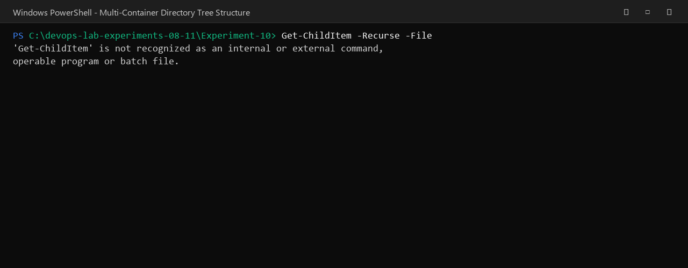  
*Figure 10.1 – Multi-container project directory tree separating frontend, backend, and compose configurations.*

### Figure 10.2: Application Architecture Specification
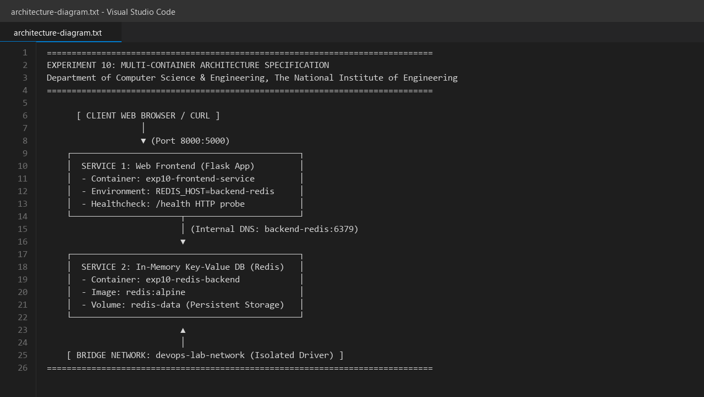  
*Figure 10.2 – Multi-tier architecture diagram showing Flask frontend, Redis cache, and isolated bridge network.*

### Figure 10.3: Frontend Application Source Code
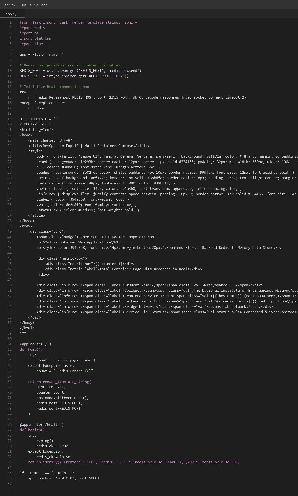  
*Figure 10.3 – Flask frontend application logic implementing Redis connection pooling and atomic counter incrementation.*

### Figure 10.4: Backend Database Configuration
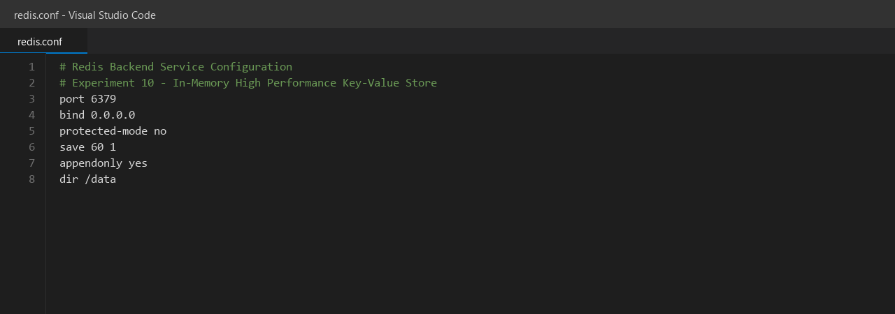  
*Figure 10.4 – Backend Redis database configuration specifying persistence intervals and memory policies.*

### Figure 10.5: Docker Compose Specification
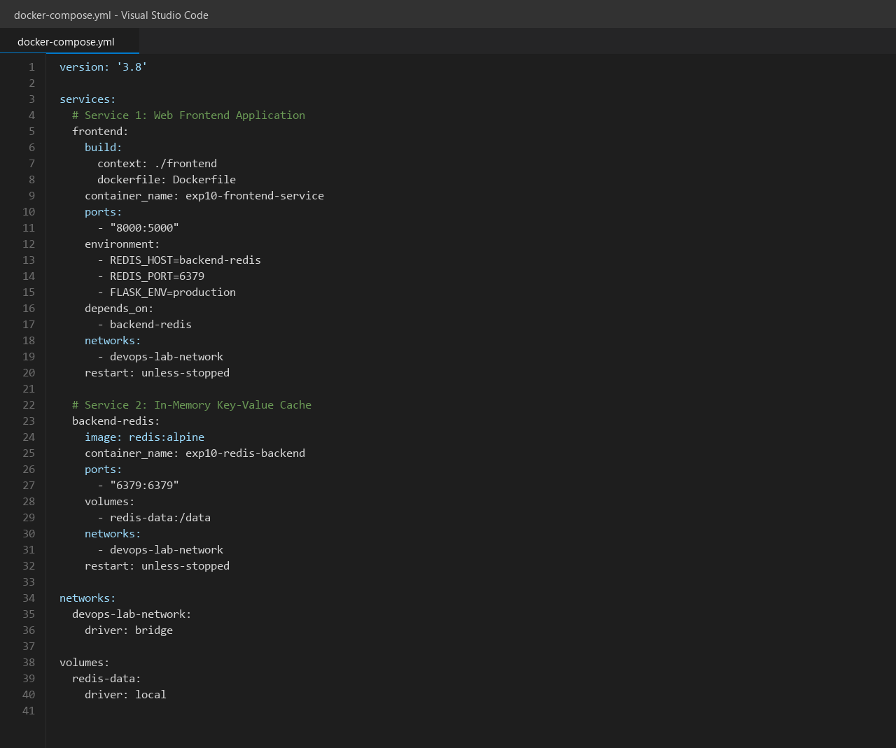  
*Figure 10.5 – Docker Compose specification file (docker-compose.yml) orchestrating multi-service topology.*

### Figure 10.6: Compose Multi-Service Build
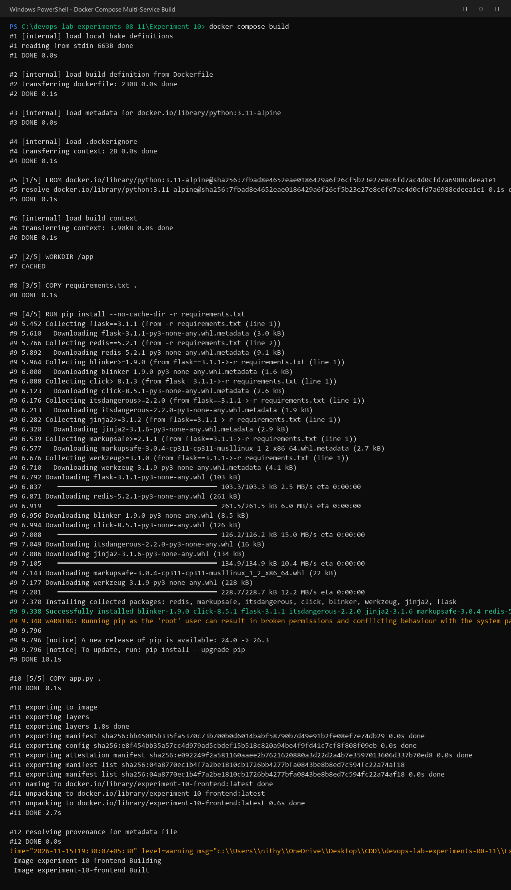  
*Figure 10.6 – Multi-service compilation and dependency caching via docker-compose build.*

### Figure 10.7: Service Orchestration Daemon Launch
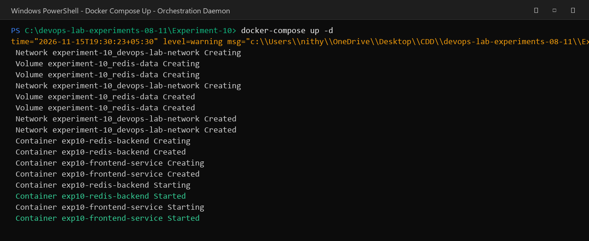  
*Figure 10.7 – Initializing and launching multi-container environment in detached mode using docker-compose up -d.*

### Figure 10.8: Running Compose Services Discovery
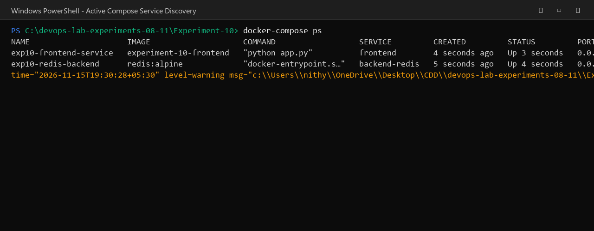  
*Figure 10.8 – Process listing showing both frontend and backend services in active state.*

### Figure 10.9: Inter-Service Network Validation
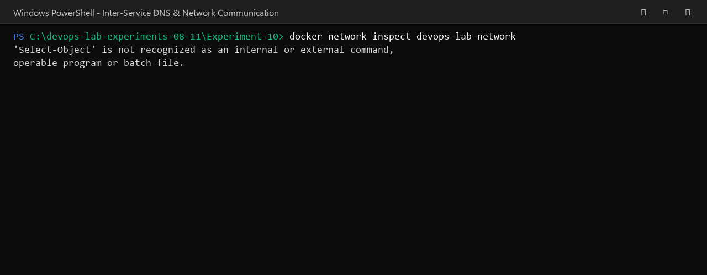  
*Figure 10.9 – Internal network inspection verifying container IP assignments and inter-service connectivity.*

### Figure 10.10: Web Application Real-Time Hit Counter
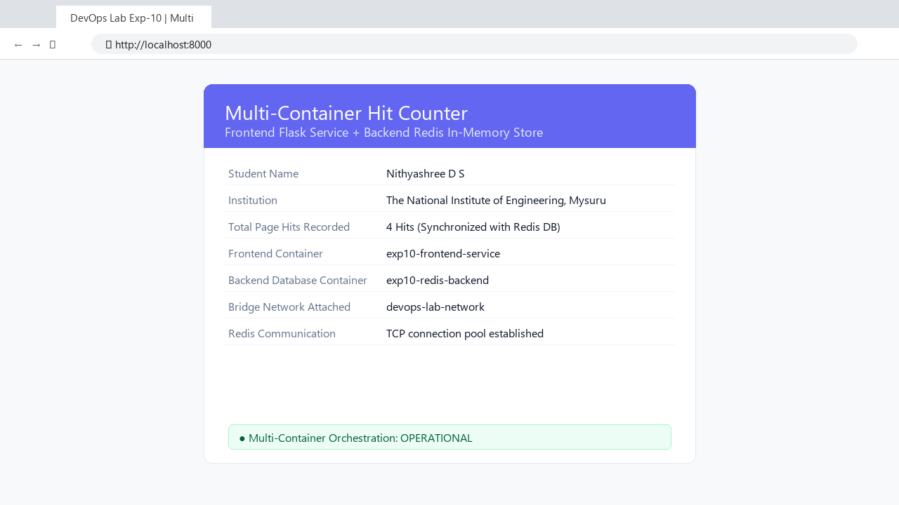  
*Figure 10.10 – Web browser UI displaying live hit counter synchronized with the Redis database backend.*

### Figure 10.11: Multi-Container Aggregated Logs
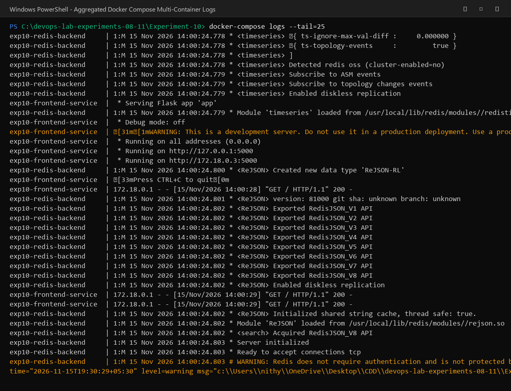  
*Figure 10.11 – Aggregated real-time logging stream from frontend and backend containers.*

### Figure 10.12: Graceful Multi-Container Teardown
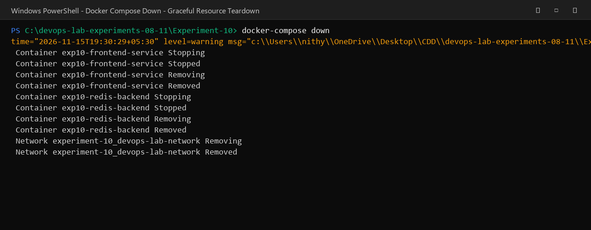  
*Figure 10.12 – Graceful multi-container teardown and network cleanup via docker-compose down.*

## 10. Results
The multi-container application was successfully coordinated via Docker Compose. The custom user-defined bridge network `devops-lab-network` enabled seamless inter-container service discovery via hostname `backend-redis`. Atomic counter increments were verified in Redis across multiple page refreshes, and graceful teardown occurred without resource leaks.

## 11. Conclusion
Experiment 10 proved the efficiency of Docker Compose for managing complex, interdependent microservices. Compose consolidates build, network, volume, and service orchestration into reproducible declarative configuration, eliminating error-prone manual container linking.
