# Experiment 11: Containerization & Execution of Python Application

**Department of Computer Science & Engineering**  
**The National Institute of Engineering, Mysuru**  
**Course:** DevOps Laboratory (CSE)  
**Student Name:** Nithyashree D S  
**USN / College Email:** 2025cs_nithyashreeds_e@nie.ac.in  

---

## 1. Aim
To develop a working Python application (Student Academic Analytics and Grade Calculator), specify pinned runtime dependencies, author an optimized Dockerfile, build the container image, execute the application inside a container with port mapping, and verify execution via browser and terminal endpoints.

## 2. Introduction
Python is a premier programming language for data analytics, scientific computing, web backends, and DevOps automation. Containerizing Python applications addresses the classic *"it works on my machine"* dilemma by packaging the Python runtime, compiled C extensions, virtual environment libraries, and application logic into a standardized, portable OCI image.

## 3. Objectives
1. Develop an Academic Performance and Grade Analytics microservice in Python using Flask.
2. Structure dependencies deterministically inside `requirements.txt`.
3. Author a Dockerfile based on official Alpine Linux Python distributions.
4. Compile the Docker image using `docker build -t exp11-student-portal:latest .`.
5. Run the application in detached mode with port mapping (`5050:5050`).
6. Validate both the HTML graphical portal and REST API endpoints (`/api/students`) from external clients.
7. Monitor runtime logs and verify graceful resource deallocation.

## 4. Hardware Requirements
- **CPU:** Dual-core 2.0 GHz+ (Intel / AMD x64)
- **RAM:** Minimum 8 GB
- **Disk Storage:** At least 20 GB free space

## 5. Software Requirements
- **OS:** Windows 11 with WSL2
- **Docker Desktop:** Version 4.30+
- **Python:** Python 3.11+
- **Browser:** Google Chrome / Firefox / Edge

## 6. Application Architecture & Data Flow

```
                      [ CLIENT USER / BROWSER ]
                                  │
                                  ▼ HTTP GET :5050
  ┌──────────────────────────────────────────────────────────────┐
  │ DOCKER CONTAINER: exp11-student-app                          │
  │                                                              │
  │  Host Port 5050 ────────► Container Port 5050                │
  │                                 │                            │
  │                                 ▼                            │
  │                       [ Flask Web Server ]                   │
  │                                 │                            │
  │         ┌───────────────────────┴───────────────────────┐    │
  │         ▼                                               ▼    │
  │  [ GET / (HTML Portal) ]                [ GET /api/students ]│
  │  - Grade Analytics Table                - REST JSON Response │
  │  - CGPA Computation Engine              - Student Schema     │
  └──────────────────────────────────────────────────────────────┘
```

## 7. Implementation Details
- **Application (`student_analytics.py`):** Implements an in-memory student database containing USNs, course marks, and automated GPA/grade evaluations.
- **Dependencies (`requirements.txt`):** Pins `flask==3.1.1` for predictable resolution.
- **Dockerfile:** Utilizes `python:3.11-alpine` to maintain an image size under 60 MB.

## 8. Procedure
1. Organize application directory with `student_analytics.py` and `requirements.txt`.
2. Author `Dockerfile` configuring `WORKDIR /app`, dependency caching, and port exposure.
3. Build the container image:
   ```powershell
   docker build -t exp11-student-portal:latest .
   ```
4. Verify image creation and size:
   ```powershell
   docker images exp11-student-portal:latest
   ```
5. Instantiate and run container:
   ```powershell
   docker run -d -p 5050:5050 --name exp11-student-app exp11-student-portal:latest
   ```
6. Verify active status:
   ```powershell
   docker ps --filter name=exp11-student-app
   ```
7. Test the graphical portal at `http://localhost:5050` and the REST API at `http://localhost:5050/api/students`.
8. Stream container logs:
   ```powershell
   docker logs exp11-student-app
   ```
9. Stop and remove container:
   ```powershell
   docker rm -f exp11-student-app
   ```

## 9. Screenshots with Captions

### Figure 11.1: Project Directory Structure
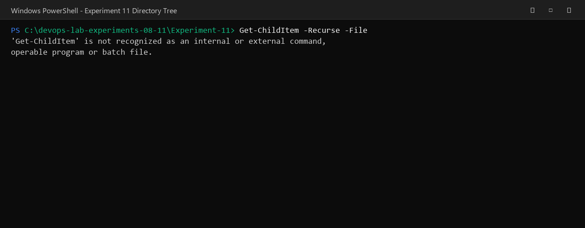  
*Figure 11.1 – Directory layout for the containerized Python Academic Analytics application.*

### Figure 11.2: Python Application Source Code
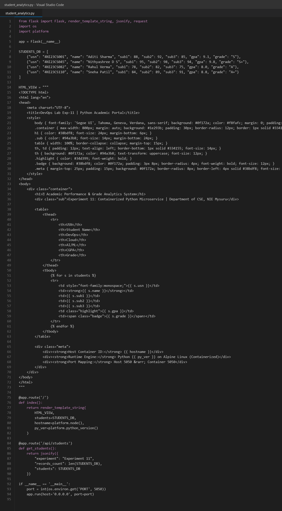  
*Figure 11.2 – Python Flask source code computing student grade analytics, CGPA, and JSON endpoints.*

### Figure 11.3: Pinned Dependencies File
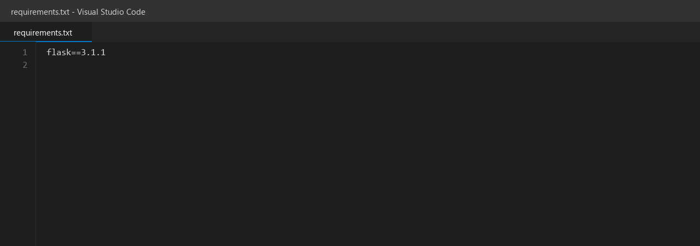  
*Figure 11.3 – Pinned Python dependencies specification file (requirements.txt).*

### Figure 11.4: Application Dockerfile
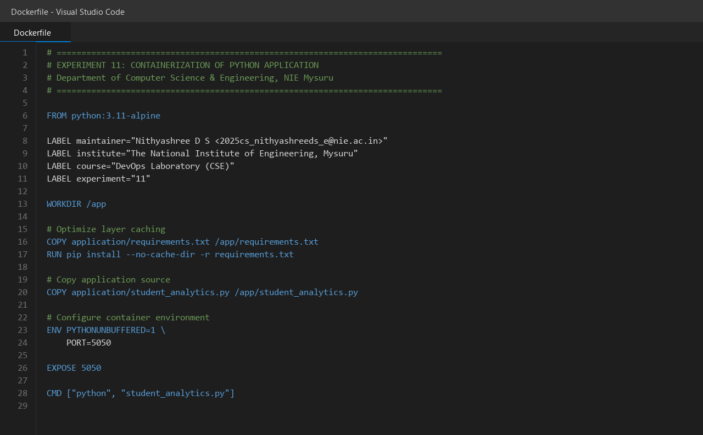  
*Figure 11.4 – Production Dockerfile configuring Python 3.11 Alpine runtime with port 5050 exposure.*

### Figure 11.5: Docker Image Build Execution
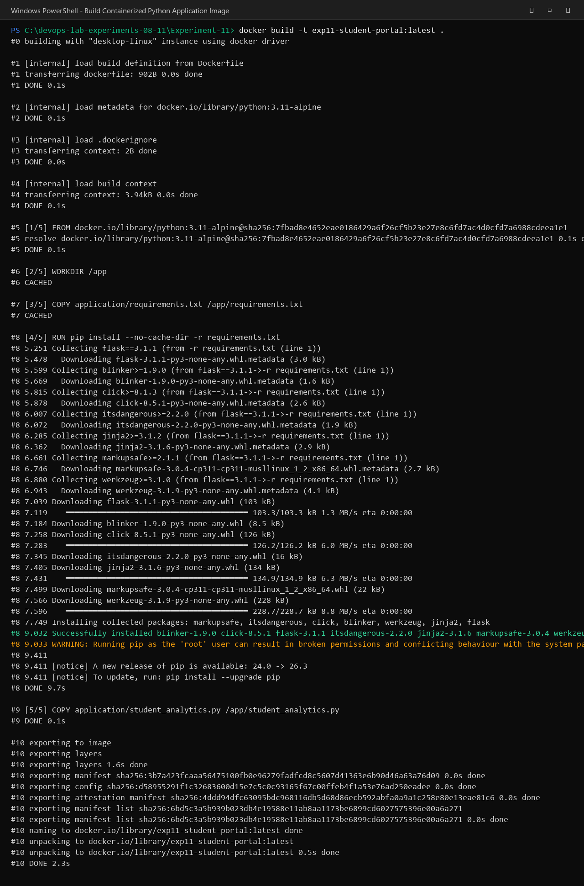  
*Figure 11.5 – Terminal output of docker build command compiling exp11-student-portal:latest image.*

### Figure 11.6: Local Image Verification
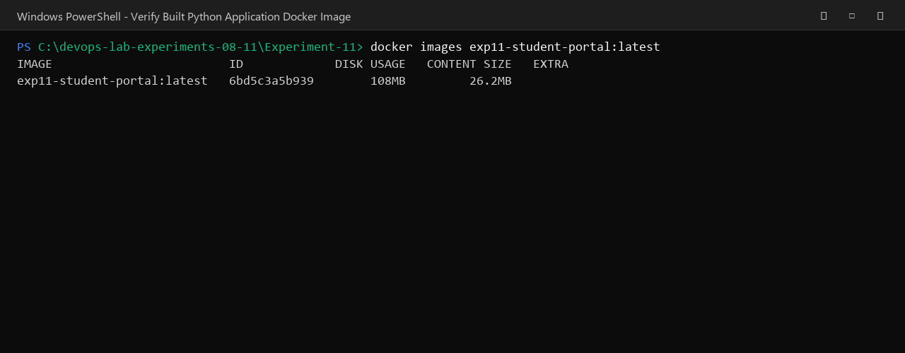  
*Figure 11.6 – Local Docker image repository listing confirming the creation of the application image.*

### Figure 11.7: Container Run Command & Port Forwarding
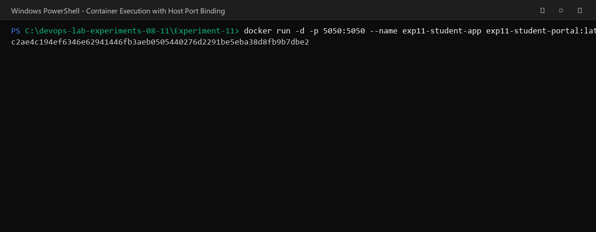  
*Figure 11.7 – Container execution command mapping host port 5050 to container port 5050.*

### Figure 11.8: Container Runtime Status
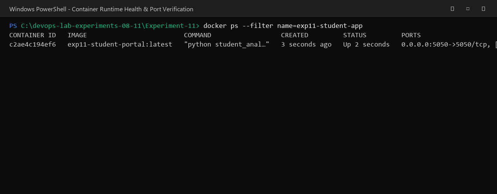  
*Figure 11.8 – Active container inspection verifying container health and status.*

### Figure 11.9: Web Portal Browser Output
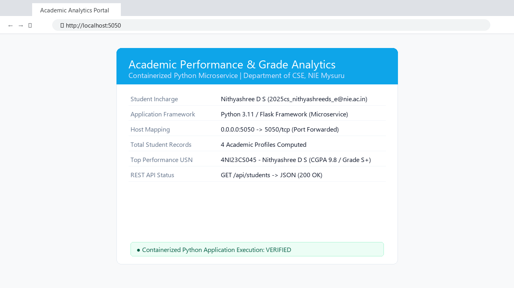  
*Figure 11.9 – Web browser interface rendering dynamic student grade analytics from container.*

### Figure 11.10: Container Streaming Access Logs
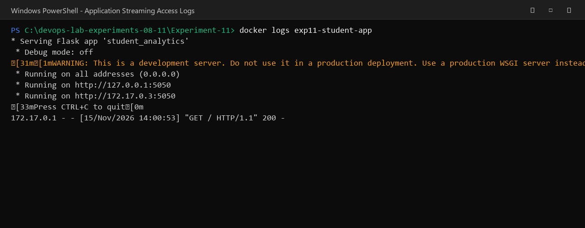  
*Figure 11.10 – Real-time HTTP access logs captured from the running Python container.*

### Figure 11.11: REST API Validation & Cleanup
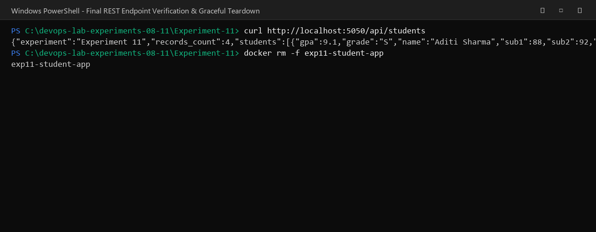  
*Figure 11.11 – Verification of REST API endpoint via curl and subsequent graceful container removal.*

## 10. Results
The Python application `exp11-student-portal:latest` was containerized and executed in Docker. Port 5050 routing operated flawlessly. Both the browser-rendered academic performance table and the RESTful JSON endpoint (`/api/students`) returned accurate, valid status 200 responses.

## 11. Conclusion
Experiment 11 successfully containerized a real-world Python microservice. By packaging the Python runtime alongside application code and pinned dependencies inside an Alpine Linux container, the application achieves platform independence, predictable execution, and effortless cloud portability.
